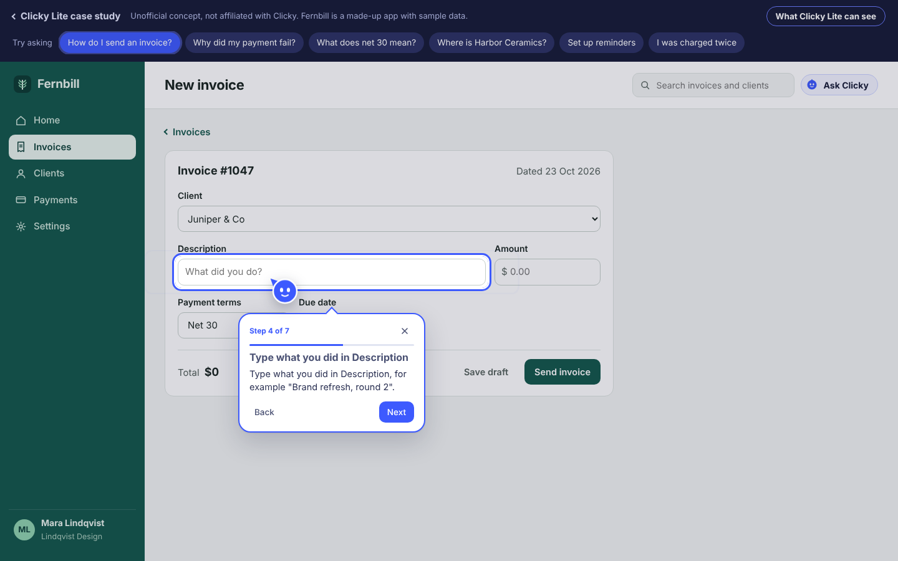
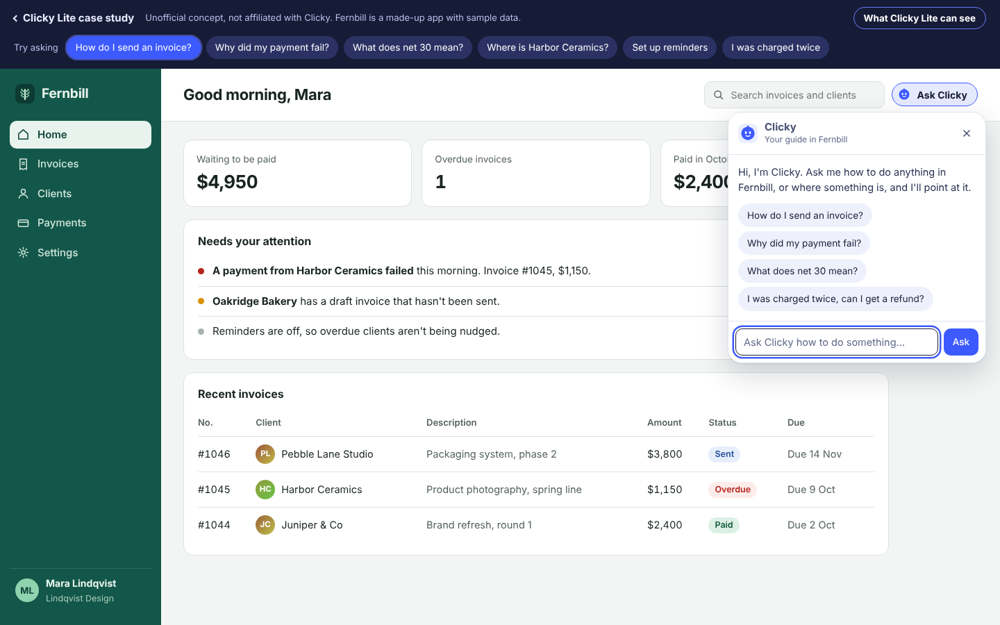
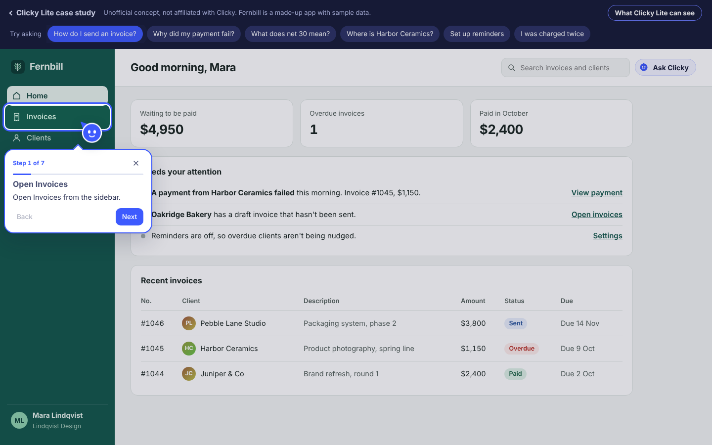
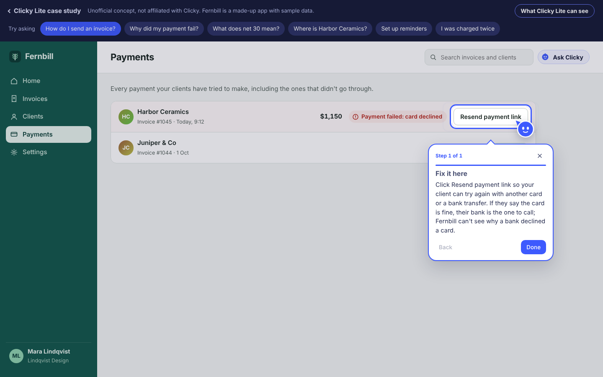
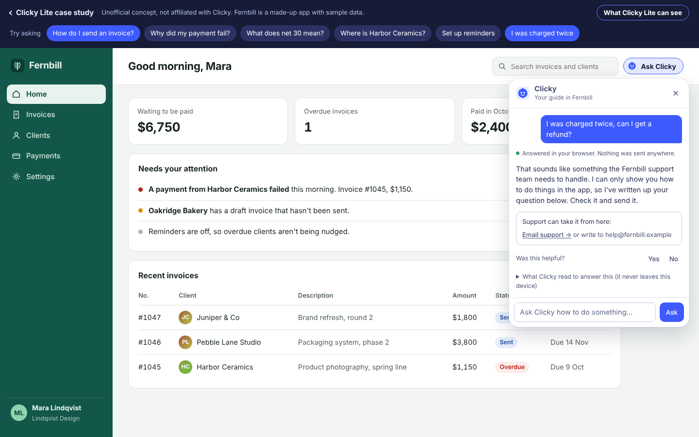
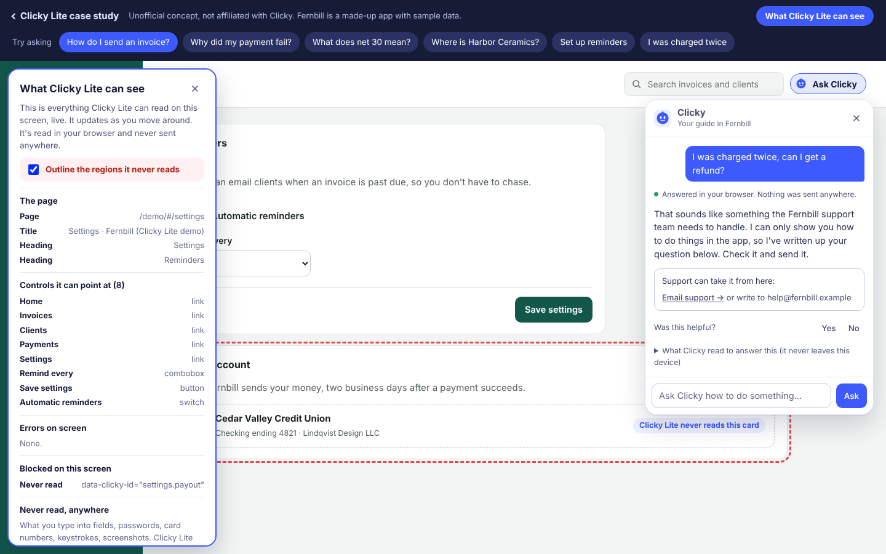

# Clicky Lite: a Clicky concept for every web app

> **Not affiliated with Clicky.** This is an independent, unofficial concept made for fun by Nitai Weinberg, a paying Clicky customer, as a product sense case study. It isn't a real or planned product, and it isn't endorsed by or connected to Clicky (Hey Clicky) or its makers. Clicky and Hey Clicky are trademarks of their respective owner. The cursor buddy here is an original drawing, not Clicky's. Fernbill and everyone in the demo are fictional.



**You're a Clicky user. Your customers aren't.** Clicky Lite is one script tag that puts a Clicky-style guide inside any web app. A customer asks "how do I send an invoice?", and a small buddy flies to the right button, explains the step in a speech bubble, and moves on when they actually do it. Nothing for the customer to install.

- **Live:** https://nweinberg97.github.io/Clicky-Lite/
- **Demo app:** https://nweinberg97.github.io/Clicky-Lite/demo/

## The case in short

- **Problem.** Clicky's value is locked behind a Mac app install, so it reaches only people who go looking for it. Meanwhile SaaS teams drown in "how do I…" tickets that their help center already answers, and lose new users during onboarding.
- **Who.** The buyer is a product-led SaaS team that owns activation and support. The user is their non-technical customer, who lives in a browser and won't install anything.
- **Why Clicky.** Distribution (every web app becomes a Clicky surface), a second, B2B revenue line, and brand ("Clicky" as the word for "show me where to click").
- **Metrics.** Activation lift and ticket deflection against a holdout, walkthrough completion, pointing accuracy, and Lite to Clicky desktop conversions.
- **Risks.** Wrong pointing, privacy inside someone else's product, latency and brand dilution. Each has a mitigation on the landing page.
- **Out of scope.** Agents or automation acting for users, voice unless the browser supports it reliably, screenshots, native mobile.

## Try the demo

Fernbill is a made-up invoicing app with Clicky Lite installed. Tap a suggested question in the bar at the top, or open **Ask Clicky**:

| Ask | What happens |
|---|---|
| How do I send an invoice? | A 7-step walkthrough. The buddy points at Invoices, then New invoice, then each field, and advances as you click and fill them in. |
| Why did my payment fail? | Reads the "card declined" error on the Payments page, explains it from the docs and points at **Resend payment link**. Asked from another page, it offers to walk you there. |
| What does net 30 mean? | Answers from the help center glossary. |
| Where is Harbor Ceramics? | The finder: points at the matching row, or, from another page, at Clients first and then at the row once you're there. Also "invoice 1045", "take me to settings", "where do I put the amount". |
| Download an invoice as PDF | Says plainly that Fernbill can't, and offers support. Unknown questions get 2-3 tappable suggestions. |
| Set up reminders (from Settings) | Starts at step 3, because you're already on Settings. |
| I was charged twice | Hands off to support with a prefilled email for you to review and send. |

**What Clicky Lite can see** (top right) lists live everything it can read on the current screen, and can outline the regions it never reads (the payout account, private client notes).

The demo loads its knowledge pack from an embedded script (`demo/clicky-pack.js`) rather than fetching JSON, so it also runs inside sandboxed viewers with an opaque origin and a strict CSP. A normal install uses the one-line `data-clicky-pack` URL shown on the landing page.

Voice input appears only where the browser can recognise speech on the device. Elsewhere the mic stays hidden and text works as normal.

## The flow

| | | |
|---|---|---|
|  **1. Ask** |  **2. The buddy points** |  **3. It follows along** |
|  **4. Errors explained** |  **5. Support handoff** |  **6. What it can see** |

More in [`screenshots/`](screenshots), including phone sizes.

## How it's built

Clicky Lite is **built on the Navoro engine**, Nitai's in-app guidance project, running in its fully local mode and reskinned here:

- `engine/sdk/src/` is the Navoro browser SDK, forked. Attributes are renamed to `data-clicky-*`, the global is `window.ClickyLite`, and the styling is new. Clicky Lite adds the cursor buddy that flies to each target with a speech-bubble step card, `ClickyLite.see()` and `blockedRegions()` for the "what it can see" panel, and routing to a fix that's on another page.
- `engine/packages/engine/` is Navoro's on-device answer engine (BM25 retrieval, walkthroughs, troubleshooting, glossary, support handoff, start-where-you-are).
- `engine/server/knowledge/` is Navoro's pack builder, which turns Markdown help docs into a static knowledge pack. Clicky Lite adds `Also asked as:` phrasings, `## Not available:` sections, synonyms and finder places.
- `engine/sdk/src/finder.ts` is new: the on-screen finder ("where is…", "find…", bare nouns), with short routes to other pages and privacy refusals.

Nothing is sent anywhere. The only requests are the SDK script and the knowledge pack, both static files.

### Files

| Path | What it is |
|---|---|
| `index.html`, `site.css`, `site.js` | Landing page and case study |
| `demo/` | Fernbill, the fictional host app (`app.js`, `app.css`), the "what it can see" panel (`see.js`) |
| `demo/help/fernbill-help.md` | Fernbill's help center, the only source of answers |
| `demo/clicky.config.json`, `demo/clicky.elements.json` | Clicky Lite config: docs, tagged controls, privacy rules, greeting |
| `demo/clicky-pack.json` | Built knowledge pack (committed) |
| `sdk/clicky-lite.js` | Built SDK bundle (committed, about 81 KB minified) |
| `engine/` | TypeScript sources (forked from Navoro) |
| `scripts/build.mjs` | Rebuilds the SDK, the pack and the embedded `demo/clicky-pack.js` |
| `tests/sandbox_server.py`, `tests/regression.py` | A viewer-like sandboxed iframe with a strict CSP, and 50+ phrasings with expected outcomes |

## Running it

It's a static site. The built files are committed, so there's no build step to view it:

```sh
python3 -m http.server 8000
# open http://localhost:8000/ and http://localhost:8000/demo/
```

To change the help docs or the SDK, rebuild (Node 22.18+):

```sh
npm install      # esbuild only
npm run build    # writes sdk/clicky-lite.js and demo/clicky-pack.json
```

### Testing

```sh
python3 tests/sandbox_server.py &                  # site with a strict CSP on :8765, sandbox host on :8766
python3 tests/regression.py --width 600            # opaque-origin sandbox, side-panel width
python3 tests/regression.py --same --width 1280    # with allow-same-origin
```

### Publishing on GitHub Pages

Settings → Pages → Deploy from a branch → `main`, `/ (root)`. The site appears at `https://nweinberg97.github.io/Clicky-Lite/`.

## Credits

Concept, case study and prototype by **Nitai Weinberg**. Built on the Navoro engine. Typefaces: Bricolage Grotesque, Atkinson Hyperlegible and Figtree (Google Fonts). No Clicky assets, logos or copy are used.
